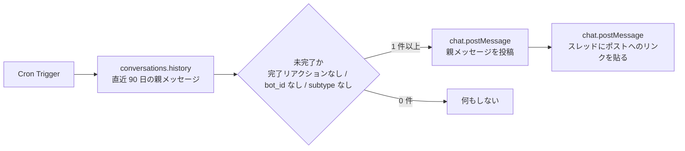

# Nostos

Slack の Todo 用チャンネルで、完了リアクションが付いていないユーザー発言を毎朝集めて、同じチャンネルに再通知する Cloudflare Worker です。Rust を Wasm にコンパイルして動かします。対象チャンネルは複数指定できます。

Todo が増えると未完了のものが上に流れて埋もれます。Nostos は毎朝決まった時刻に、親メッセージを 1 件投稿し、そのスレッドに該当ポストへのリンクを貼ります。同梱の `wrangler.toml.example` は UTC 0:00 (JST 9:00) に設定してあります。

## 動作



投稿の例です。親メッセージにはこう出ます。

```text
おはようございます！未完了のTodoが2件あります。スレッドにリンクを貼ります。
```

スレッドには、該当ポストへのリンクが 1 行ずつ貼られます。リンクの表示名はポストの先頭 40 文字です。

```text
・【3】牛乳を買う
・電球を替える
```

`bot_id` と `subtype` が付いた投稿は除外します。これがないと、Nostos 自身の投稿を次の朝に Todo として拾ってしまいます。

複数チャンネルを指定した場合はチャンネルごとに同じ処理を行い、それぞれのチャンネルにそのチャンネルの分だけを投稿します。1 つのチャンネルで失敗しても（Bot 未招待、チャンネル削除など）、残りのチャンネルの処理は続行し、失敗はログに残ります。

## 優先度

`:one:` 〜 `:five:` のリアクション（カスタム絵文字の `:1:` 〜 `:5:` でも可）を優先度 1〜5 として扱い、優先度が高いものからスレッドに並べます。複数付いていれば最大値を使い、なければ 0 です。優先度のある行には、行頭に `【3】` のように数字が付きます。同じ優先度の中では、チャンネルでの新しい順のままです。

## 必要なもの

- Rust (stable) と `wasm32-unknown-unknown` ターゲット
- Node.js (`wrangler` 用)
- Cloudflare アカウント
- Slack App を作れるワークスペース

```sh
rustup target add wasm32-unknown-unknown
npm install
```

## Slack App の準備

1. [Slack API](https://api.slack.com/apps) の Create New App から From a manifest を選び、`slack-manifest.yml` を貼って App を作成します。手動で作る場合は次の scope を設定します。
2. Bot Token Scopes に次を追加します。
   - `channels:history` (パブリックチャンネルの履歴を読む)
   - `chat:write` (リマインドを投稿する)
   - プライベートチャンネルで使う場合は `groups:history` も追加します。
3. ワークスペースにインストールし、Bot User OAuth Token (`xoxb-...`) を控えます。
4. Todo 用に使うチャンネルで `/invite @<App 名>` を実行し、Bot を招待します。招待しないと履歴を読めません。複数チャンネルで使う場合は、チャンネルごとに招待します。
5. そのチャンネルの ID を控えます。チャンネル名を右クリックして詳細を開くと、末尾に ID があります。複数ある場合は ID をすべて控えます。

## セットアップ

`wrangler.toml` と `.dev.vars` は `.gitignore` 対象です。リポジトリにあるテンプレートをコピーして使います。

```sh
cp wrangler.toml.example wrangler.toml
cp .dev.vars.example .dev.vars
```

`.dev.vars` に `SLACK_BOT_TOKEN` と `SLACK_CHANNEL_ID` を書きます。複数チャンネルを対象にする場合は、`SLACK_CHANNEL_ID` に ID をカンマ区切りで並べます（例: `C0000000000,C1111111111`）。トークンやチャンネル ID をコードやコミットに入れないでください。

## ローカルで動かす

```sh
npm run dev
```

Cron は自動では走りません。`wrangler dev --test-scheduled` で起動し、次のリクエストでスケジュール実行を手動で起こせます。

```sh
curl "http://localhost:8787/__scheduled?cron=0+0+*+*+*"
```

実行すると、`SLACK_CHANNEL_ID` のチャンネルに実際に投稿されます。複数指定している場合は全チャンネルに投稿されるので、試すときは専用のテストチャンネルを使うと安全です。

## デプロイ

秘密情報を Cloudflare に登録してからデプロイします。

```sh
npx wrangler secret put SLACK_BOT_TOKEN
npx wrangler secret put SLACK_CHANNEL_ID
npm run deploy
```

Wasm のビルドは `wrangler.toml` の `[build]` が `worker-build --release` を呼ぶので、手動では実行しません。

`main` への push では、GitHub Actions の `deploy` ジョブが同じ手順で自動デプロイします。リポジトリの Secrets に `CLOUDFLARE_API_TOKEN`（Account の Workers Scripts: Edit だけを付けたトークン）と `CLOUDFLARE_ACCOUNT_ID` を登録してください。

## 設定

| 名前 | 内容 | 設定場所 |
| --- | --- | --- |
| `SLACK_BOT_TOKEN` | Bot User OAuth Token | `.dev.vars` / `wrangler secret` |
| `SLACK_CHANNEL_ID` | 読み取りと投稿の対象にするチャンネルの ID。カンマ区切りで複数指定可（重複は無視） | `.dev.vars` / `wrangler secret` |
| `DONE_REACTION` | 完了とみなすリアクション名（コロンなし）。省略すると `done` | `.dev.vars` / `wrangler secret` または `wrangler.toml` の `[vars]` |
| `crons` | 実行時刻 (UTC) | `wrangler.toml` の `[triggers]` |

実行時刻を変えるときは `crons` を編集します。JST は UTC より 9 時間進んでいます。

## 開発

```sh
cargo test
cargo clippy --target wasm32-unknown-unknown -- -D warnings
```

フィルタリングとメッセージ整形は `src/filter.rs` の純粋関数で、`cargo test` で検証します。チャンネル ID の解析も純粋関数として `src/config.rs` にあります。Slack との通信は `src/slack.rs`、Cron のエントリポイントは `src/lib.rs` にあります。

```text
src/
├── lib.rs      scheduled イベントと全体の組み立て
├── config.rs   SLACK_CHANNEL_ID の解析（カンマ区切りで複数チャンネル）
├── slack.rs    API レスポンスの型、history 取得、投稿
└── filter.rs   未完了判定とリマインド文の整形
```

Wasm 環境のため HTTP は `worker::Fetch` を使います。`reqwest` などは使えません。

## 制限

- 対象は親メッセージのみで、スレッド内の発言は拾いません。
- 対象期間は過去 90 日です。Slack 無料版の履歴制限に合わせています。

## ライセンス

[MIT](LICENSE)
