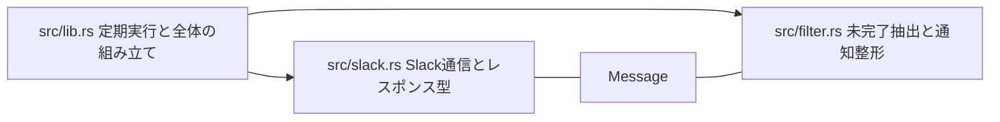

# Graph Report - nostos  (2026-10-29)

## 構成の見取り図

READMEに記載された責務を示す。図の矢印は関数呼び出しの検証結果ではない。

README.md:116–125 が各ファイルの責務を示す。ASTグラフでは Message が抽出と通信のグループをつなぐ。

## 抽出の制限

- 小規模なコーパス（9ファイル、約2,266語）なので、全文を直接読む方法も実用的。
- Cargo.toml は構造抽出でシンボルが得られなかった。
- 整合性診断: 抽出データ内に参照先ノードがない関係14件、同じノード対への集約12件。後者は有向・無向診断で同じ12件を報告しており、合計24件ではない。欠落や集約の可能性があるため、このグラフを完全な呼び出し図とは扱わない。
- 文書由来の要件とコード由来のノードは別々に抽出した。文書の記述だけで実装済みとは判定していない。
- graphify-out/ は作業ツリーに生成したため git status に表示される。.gitignore へ追加するか、共有したい成果物だけをコミットできる（https://docs.graphify.com/guides/team-workflows）。

## Corpus Check
- Corpus is ~2,266 words - fits in a single context window. You may not need a graph.

## Summary
- 147 nodes · 188 edges · 9 communities (8 shown, 1 thin omitted)
- Extraction: 98% EXTRACTED · 2% INFERRED · 0% AMBIGUOUS · INFERRED: 3 edges (avg confidence: 0.88)
- Token cost: 計測不可。この環境のサブエージェント結果には実使用量がなく、cost.json の 0 は未計測のプレースホルダー。無料を意味しない。

## Community Hubs (Navigation)
- タスク抽出と整形
- 要件と運用設計
- Slack API 通信
- Slack App 設定
- CI ジョブ構成
- CI 実行と認証
- Wrangler 開発環境
- 定期実行の制御
- パッケージ識別

## God Nodes（接続数の多いノード）

1. `Message` — 13
2. `unfinished_tasks()` — 10
3. `with` — 6
4. `deploy` — 6
5. `format_thread_replies()` — 6
6. `親通知とスレッドのTodoリンク` — 6
7. `steps` — 5
8. `scheduled()` — 5
9. `auth_headers()` — 5
10. `steps` — 4

## Surprising Connections（文書間の接点）

- 日時解析による優先順位構想 ↔ リアクションによる優先度1〜5［INFERRED］
- 完了スタンプ名の設定化構想 ↔ `DONE_REACTION` 設定［INFERRED］
- `auth.test` によるリンク生成 → スレッドのTodoリンク［EXTRACTED］
- 親投稿の `ts` を `thread_ts` に利用 → スレッドのTodoリンク［EXTRACTED］
- serdeによるデシリアライズ ↔ `src/slack.rs` のレスポンス型［INFERRED］

いずれも `docs/nostos.md` と `README.md` の接点。構想と現行記述の関係を示す。

## Import Cycles
- None detected.

## Hyperedges (group relationships)
- **Rust学習の実装手順** — docs_nostos_pair_programming, docs_nostos_serde, readme_filter_module, readme_worker_fetch, readme_lib_module [EXTRACTED 1.00]

## Communities (9 total, 1 thin omitted)

### Community 0 - "タスク抽出と整形"
Cohesion: 0.10
Nodes (18): CHUNK_LIMIT, format_thread_replies(), formats_one_link_line_per_task(), is_unfinished(), keeps_original_order_within_same_priority(), label(), LABEL_LIMIT, labels_with_first_non_empty_line() (+10 more)

### Community 1 - "要件と運用設計"
Cohesion: 0.11
Nodes (22): auth.test によるリンク生成, Phase 2 記録 完了スタンプ名の設定化, Phase 2 構想 日時解析による優先順位, OSS とセルフホスト, Nostos Phase 1 要件, serde によるSlackレスポンスのデシリアライズ, 親投稿のtsをthread_tsに利用, chat.postMessage (+14 more)

### Community 2 - "Slack API 通信"
Cohesion: 0.10
Nodes (10): API_BASE, auth_headers(), AuthTestResponse, fetch_history(), HistoryResponse, PAGE_LIMIT, post_message(), PostResponse (+2 more)

### Community 3 - "Slack App 設定"
Cohesion: 0.13
Nodes (14): always_online, display_name, display_information, description, name, features, bot_user, oauth_config (+6 more)

### Community 4 - "CI ジョブ構成"
Cohesion: 0.14
Nodes (13): concurrency, if, needs, runs-on, jobs, deploy, rust, name (+5 more)

### Community 5 - "CI 実行と認証"
Cohesion: 0.20
Nodes (12): steps, CLOUDFLARE_ACCOUNT_ID, CLOUDFLARE_API_TOKEN, steps, env, run, uses, with (+4 more)

### Community 6 - "Wrangler 開発環境"
Cohesion: 0.18
Nodes (11): allowScripts, esbuild@0.28.1, workerd@1.20261001.1, devDependencies, wrangler@^4.146.0, name, private, scripts (+3 more)

### Community 7 - "定期実行の制御"
Cohesion: 0.28
Nodes (4): DEFAULT_DONE_REACTION, LOOKBACK_DAYS, run(), scheduled()

## Knowledge Gaps
- **3 isolated node(s):** `nostos`, `Phase 2 構想 日時解析による優先順位`, `Phase 2 記録 完了スタンプ名の設定化`
  These have ≤1 connection - possible missing edges or undocumented components. (Counts symbols only; 69 node(s) total have ≤1 connection when file, concept and rationale nodes are included.)
- **1 thin communities (<3 nodes) omitted from report** — run `graphify query` to explore isolated nodes.

## Suggested Questions（探索できる問い）

- `Message` はタスク抽出とSlack通信をどうつなぐか？（媒介中心性 0.055）
- `nostos` とPhase 2の2構想は他の部分とどうつながるか？（弱い接続の3ノード）
- タスク抽出と整形のグループを分ける余地はあるか？（凝集度 0.0957983193277311）
- `deploy` はCIジョブ構成とCI実行・認証をどうつなぐか？（媒介中心性 0.014）
- 要件と運用設計のグループを分ける余地はあるか？（凝集度 0.11333333333333333）
- `steps` はCI実行・認証とCIジョブ構成をどうつなぐか？（媒介中心性 0.013）
- Slack API通信のグループを分ける余地はあるか？（凝集度 0.10144927536231885）
